# Monitorización de sistemas Linux

Práctica de monitorización con herramientas de línea de comandos en **Ubuntu Linux**. Para cada herramienta se documenta su finalidad, su sintaxis con las opciones más útiles, una captura de su ejecución y la interpretación de la salida desde el punto de vista de un administrador de sistemas.

## Índice

1. [Instalación de las herramientas](#1-instalación-de-las-herramientas)
2. [Procesos y CPU](#2-procesos-y-cpu)
   - [ps](#ps) · [top](#top) · [htop](#htop) · [atop](#atop)
3. [Memoria RAM](#3-memoria-ram)
   - [free](#free)
4. [Almacenamiento](#4-almacenamiento)
   - [df](#df) · [du](#du) · [iostat](#iostat)
5. [Tráfico de red](#5-tráfico-de-red)
   - [tcpdump](#tcpdump) · [tcptrack](#tcptrack) · [iptraf-ng](#iptraf-ng) · [bmon](#bmon)
6. [Puertos y conexiones](#6-puertos-y-conexiones)
   - [ss](#ss) · [nmap](#nmap)
7. [Análisis de resultados](#7-análisis-de-resultados)

---

## 1. Instalación de las herramientas

`ps`, `top`, `free`, `df`, `du` y `ss` vienen instaladas por defecto en Ubuntu (paquetes `procps`, `coreutils` e `iproute2`). El resto hay que instalarlas desde los repositorios:

```bash
sudo apt update
sudo apt install -y htop atop sysstat tcpdump tcptrack iptraf-ng bmon nmap
```

| Herramienta | Paquete |
|---|---|
| htop | `htop` |
| atop | `atop` |
| iostat | `sysstat` |
| tcpdump | `tcpdump` |
| tcptrack | `tcptrack` |
| iptraf | `iptraf-ng` (versión actual de iptraf) |
| bmon | `bmon` |
| nmap | `nmap` |

Para saber el nombre de la interfaz de red (se usa en varias herramientas de red):

```bash
ip a
```

En los ejemplos se usa `enp0s3`; hay que sustituirlo por el nombre de la interfaz propia.

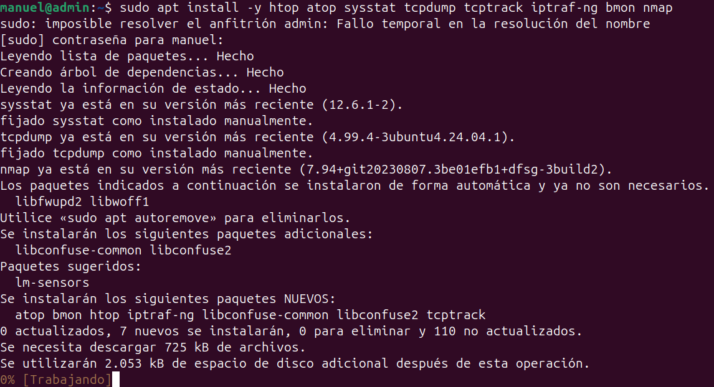

---

## 2. Procesos y CPU

### ps

**Nombre y finalidad**

`ps` (*process status*) muestra una instantánea de los procesos que se están ejecutando en el momento de lanzar el comando: su PID, el usuario propietario, el consumo de CPU y memoria, el estado y el comando que los lanzó. A diferencia de `top`, no se actualiza.

**Sintaxis**

```bash
ps [opciones]
```

| Opción | Descripción |
|---|---|
| `aux` | Muestra todos los procesos de todos los usuarios (`a`), con formato orientado al usuario (`u`) e incluyendo los que no tienen terminal (`x`). |
| `-ef` | Todos los procesos (`-e`) en formato completo (`-f`), incluyendo el PPID (proceso padre). |
| `-eo campos` | Permite elegir qué columnas mostrar. |
| `--sort=-%cpu` | Ordena por un campo; el `-` indica orden descendente. |

Ejemplos:

```bash
ps aux
ps -ef
ps -eo pid,user,%cpu,%mem,cmd --sort=-%cpu | head -n 10
```

**Captura**

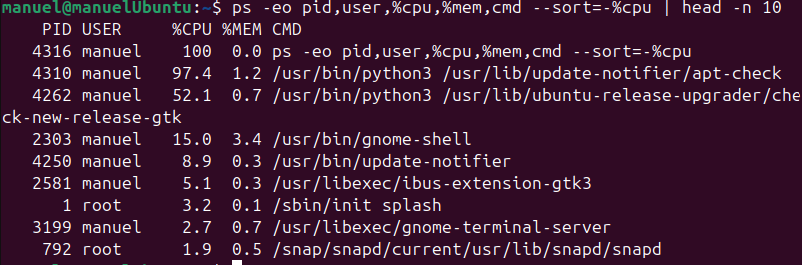

**Interpretación**

- `USER`: usuario que ejecuta el proceso.
- `PID`: identificador del proceso.
- `%CPU` / `%MEM`: porcentaje de CPU y de memoria física que consume.
- `VSZ` / `RSS`: memoria virtual y memoria física real (residente) en KB.
- `STAT`: estado (`R` ejecutándose, `S` dormido, `D` esperando E/S, `Z` zombi, `T` detenido).
- `START` / `TIME`: hora de inicio y tiempo de CPU acumulado.
- `COMMAND`: comando que lanzó el proceso.

Un administrador lo usa para localizar el PID de un proceso concreto (por ejemplo `ps aux | grep apache2`) y poder pararlo con `kill`, para ver qué procesos consumen más recursos o para detectar procesos zombi o en estado `D` que indiquen problemas de disco.

---

### top

**Nombre y finalidad**

`top` muestra en tiempo real los procesos del sistema y un resumen del estado general: tiempo encendido, carga media, uso de CPU, memoria y swap. Se actualiza cada pocos segundos.

**Sintaxis**

```bash
top [opciones]
```

| Opción | Descripción |
|---|---|
| `-d segundos` | Intervalo de actualización. |
| `-u usuario` | Muestra solo los procesos de ese usuario. |
| `-n número` | Número de actualizaciones antes de salir. |
| `-b` | Modo *batch*, útil para guardar la salida en un fichero. |

Teclas útiles dentro de `top`: `P` ordena por CPU, `M` por memoria, `k` mata un proceso, `1` muestra cada núcleo por separado y `q` sale.

```bash
top
top -d 2 -u root
top -b -n 1 > top.txt
```

**Captura**

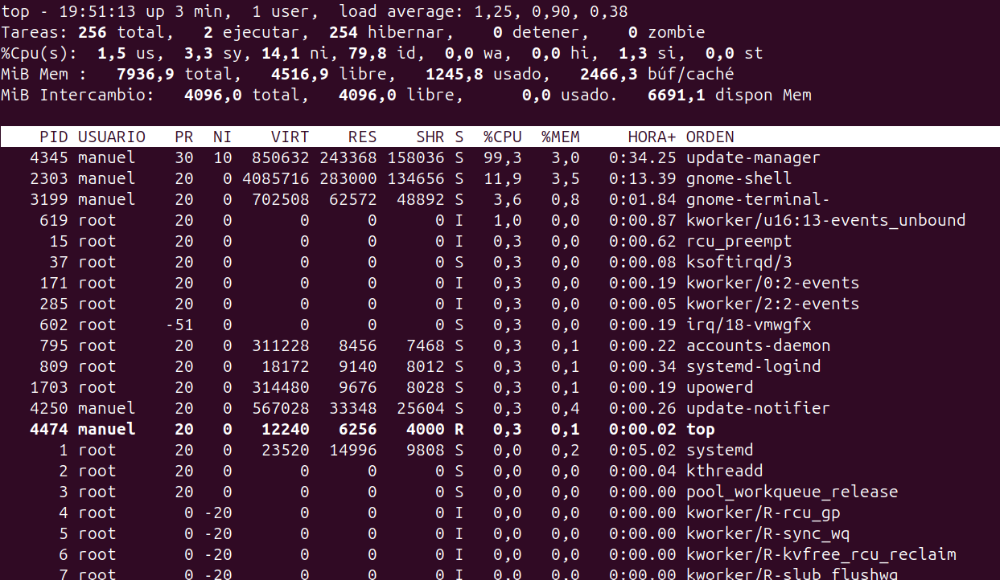

**Interpretación**

- **Primera línea**: hora, tiempo encendido (`up`), usuarios conectados y `load average` (carga media en 1, 5 y 15 minutos). Si la carga supera de forma continuada el número de núcleos, el sistema está saturado.
- **Tasks**: procesos totales, en ejecución, dormidos, detenidos y zombis.
- **%Cpu(s)**: `us` (usuario), `sy` (sistema), `ni` (prioridad modificada), `id` (inactiva), `wa` (esperando E/S de disco), `hi`/`si` (interrupciones) y `st` (tiempo robado por el hipervisor en una VM).
- **MiB Mem / MiB Swap**: memoria total, libre, usada, en caché y disponible.
- **Lista de procesos**: PID, usuario, prioridad (`PR`, `NI`), memoria (`VIRT`, `RES`, `SHR`), estado, `%CPU`, `%MEM`, tiempo y comando.

Sirve para ver de un vistazo si el servidor está sobrecargado y qué proceso es el responsable. Un `wa` alto indica que la CPU está esperando al disco.

---

### htop

**Nombre y finalidad**

`htop` es una versión mejorada e interactiva de `top`: usa colores, barras gráficas por núcleo, permite desplazarse con el ratón o las flechas, buscar, filtrar, ver procesos en árbol y matar o cambiar la prioridad de procesos sin escribir el PID.

**Sintaxis**

```bash
htop [opciones]
```

| Opción | Descripción |
|---|---|
| `-u usuario` | Muestra solo los procesos de ese usuario. |
| `-d décimas` | Intervalo de actualización en décimas de segundo. |
| `-t` | Vista en árbol (procesos padre e hijos). |
| `-p PID[,PID]` | Muestra solo los procesos indicados. |

Teclas: `F3` buscar, `F4` filtrar, `F5` árbol, `F6` ordenar, `F7`/`F8` cambiar prioridad, `F9` matar proceso, `F10` salir.

```bash
htop
htop -t
htop -u usuario
```

**Captura**

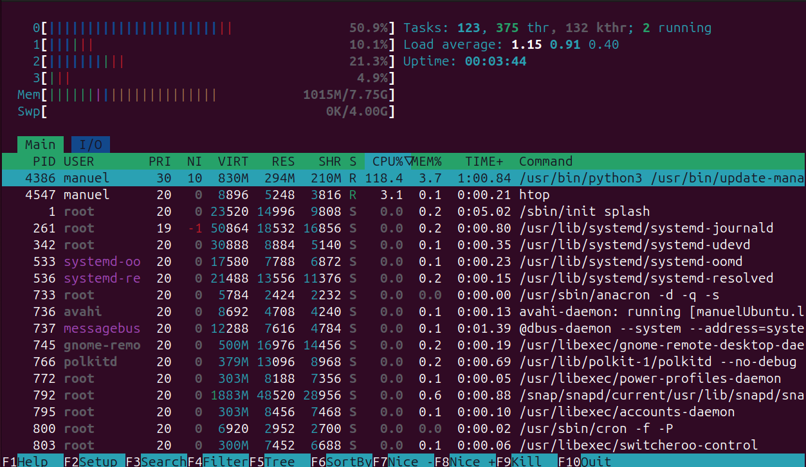

**Interpretación**

- **Barras superiores**: uso de cada núcleo de CPU, memoria (`Mem`) y swap (`Swp`). Los colores indican el tipo de uso (verde: procesos de usuario, rojo: kernel, amarillo/azul: caché y búferes).
- **Derecha**: número de tareas e hilos, `Load average` y `Uptime`.
- **Lista de procesos**: las mismas columnas que `top`.

Es más cómodo que `top` para el trabajo diario: con la vista en árbol se ve qué servicio ha lanzado cada proceso, y se pueden terminar procesos problemáticos directamente con `F9`.

---

### atop

**Nombre y finalidad**

`atop` es un monitor avanzado que muestra a la vez el uso de CPU, memoria, disco y red, tanto del sistema como de cada proceso. Además, al instalarse crea un servicio que guarda un registro histórico en `/var/log/atop/`, lo que permite revisar qué pasó en el servidor en un momento anterior.

**Sintaxis**

```bash
atop [opciones] [intervalo]
```

| Opción | Descripción |
|---|---|
| `intervalo` | Segundos entre actualizaciones (por defecto 10). |
| `-r fichero` | Lee un registro histórico guardado. |
| `-m` | Muestra los procesos ordenados por memoria. |
| `-d` | Muestra los procesos ordenados por actividad de disco. |
| `-n` | Muestra la actividad de red por proceso. |

```bash
atop 2
sudo atop -r /var/log/atop/atop_$(date +%Y%m%d)
```

Dentro del modo histórico, `t` avanza y `T` retrocede en el tiempo.

**Captura**

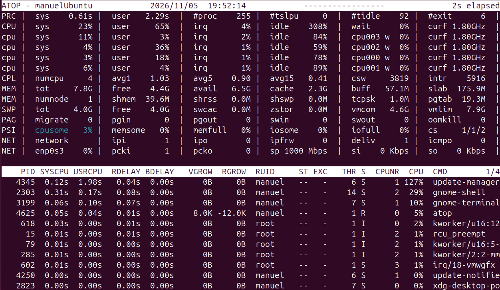

**Interpretación**

- `PRC`: procesos y tiempo de CPU de sistema y usuario.
- `CPU` / `cpu`: uso total y por núcleo.
- `CPL`: carga media del sistema.
- `MEM` / `SWP`: memoria y swap.
- `DSK`: actividad de cada disco (porcentaje de ocupación `busy`, lecturas y escrituras).
- `NET`: tráfico por capa (transporte, red) y por interfaz.
- Cuando un recurso está muy cargado, `atop` resalta la línea en color.

Su gran ventaja es el histórico: si un servidor fue lento de madrugada, un administrador puede consultar el registro de esa hora y ver qué proceso consumió los recursos.

---

## 3. Memoria RAM

### free

**Nombre y finalidad**

`free` muestra la cantidad de memoria RAM y de swap total, usada, libre y disponible.

**Sintaxis**

```bash
free [opciones]
```

| Opción | Descripción |
|---|---|
| `-h` | Formato legible (Gi, Mi). |
| `-m` / `-g` | Muestra los valores en MiB o GiB. |
| `-t` | Añade una línea con el total de RAM + swap. |
| `-s segundos` | Repite la medida cada X segundos. |

```bash
free -h
free -h -t
free -m -s 2
```

**Captura**

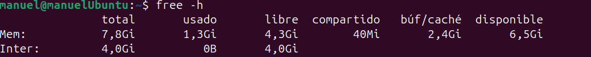

**Interpretación**

- `total`: memoria instalada.
- `used`: memoria usada por procesos.
- `free`: memoria que no se está usando para nada.
- `shared`: memoria compartida (principalmente `tmpfs`).
- `buff/cache`: memoria que Linux usa como caché de disco; se libera automáticamente si un proceso la necesita.
- `available`: estimación de la memoria disponible para nuevos programas. **Es el valor que hay que mirar**, no `free`.
- `Swap`: uso del área de intercambio. Si la swap se usa mucho y de forma continuada, al servidor le falta RAM.

---

## 4. Almacenamiento

### df

**Nombre y finalidad**

`df` (*disk free*) muestra el espacio total, usado y libre de cada sistema de ficheros montado.

**Sintaxis**

```bash
df [opciones] [sistema_de_ficheros]
```

| Opción | Descripción |
|---|---|
| `-h` | Formato legible (G, M). |
| `-T` | Muestra el tipo de sistema de ficheros (ext4, tmpfs…). |
| `-i` | Muestra el uso de inodos en lugar del espacio. |
| `-x tipo` | Excluye un tipo de sistema de ficheros. |

```bash
df -h
df -hT -x tmpfs
df -i
```

**Captura**

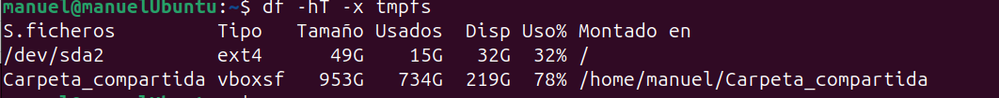

**Interpretación**

- `Filesystem`: dispositivo o partición.
- `Type`: tipo de sistema de ficheros.
- `Size` / `Used` / `Avail`: tamaño, espacio usado y disponible.
- `Use%`: porcentaje ocupado.
- `Mounted on`: punto de montaje.

Un administrador revisa sobre todo `Use%` de `/` y `/var`: si llegan al 100 % los servicios dejan de escribir logs o bases de datos y pueden caerse. Con `-i` se detecta el caso de quedarse sin inodos aunque quede espacio (muchos ficheros pequeños).

---

### du

**Nombre y finalidad**

`du` (*disk usage*) muestra cuánto espacio ocupan ficheros y directorios concretos. Se usa para encontrar qué está llenando un disco.

**Sintaxis**

```bash
du [opciones] [ruta]
```

| Opción | Descripción |
|---|---|
| `-h` | Formato legible. |
| `-s` | Muestra solo el total de la ruta indicada. |
| `-d N` / `--max-depth=N` | Profundidad máxima de subdirectorios. |
| `-a` | Incluye ficheros, no solo directorios. |
| `-c` | Muestra un total al final. |

```bash
du -sh /var/log
sudo du -h -d 1 /var | sort -h
sudo du -ah /var/log | sort -h | tail -n 10
```

**Captura**

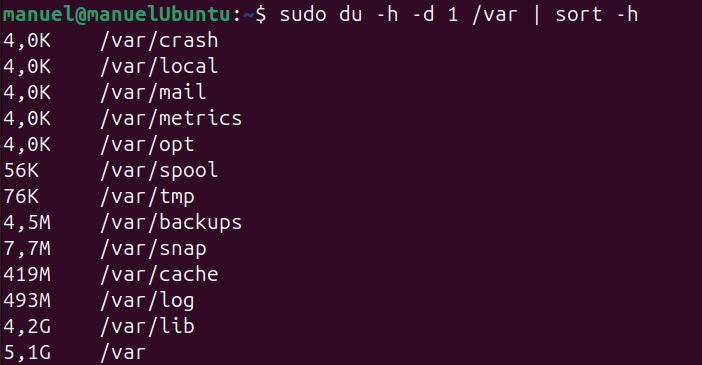

**Interpretación**

Cada línea muestra el tamaño ocupado y la ruta. Ordenando con `sort -h`, los directorios más grandes quedan al final. Si `df` avisa de que `/` está casi lleno, con `du` se baja nivel a nivel hasta localizar el culpable (normalmente logs, cachés de paquetes o copias de seguridad).

---

### iostat

**Nombre y finalidad**

`iostat` (del paquete `sysstat`) muestra estadísticas de uso de la CPU y de entrada/salida de los discos: operaciones por segundo, velocidad de lectura/escritura, tiempos de espera y porcentaje de ocupación del dispositivo.

**Sintaxis**

```bash
iostat [opciones] [intervalo] [repeticiones]
```

| Opción | Descripción |
|---|---|
| `-x` | Estadísticas extendidas (tiempos de espera, `%util`). |
| `-d` | Solo información de discos. |
| `-c` | Solo información de CPU. |
| `-h` / `-m` | Formato legible o valores en MB/s. |
| `-z` | Oculta los dispositivos sin actividad. |

```bash
iostat
iostat -xz 2 3
iostat -d -m 1 5
```

Para generar carga de disco y ver cambios en la salida:

```bash
dd if=/dev/zero of=prueba.img bs=1M count=1024 oflag=direct
rm prueba.img
```

**Captura**

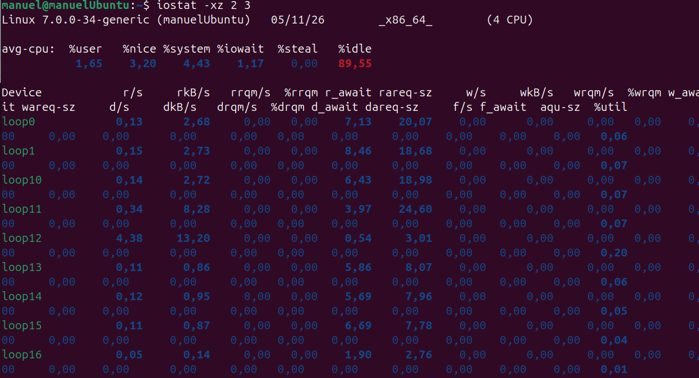

**Interpretación**

- **avg-cpu**: igual que en `top`; `%iowait` es el tiempo que la CPU pasa esperando al disco.
- `r/s` / `w/s`: lecturas y escrituras por segundo.
- `rkB/s` / `wkB/s`: velocidad de lectura y escritura.
- `r_await` / `w_await`: tiempo medio (ms) que tarda en atenderse una petición.
- `aqu-sz`: longitud media de la cola de peticiones.
- `%util`: porcentaje de tiempo que el disco ha estado ocupado. Cerca del 100 % significa que el disco está saturado.

El primer informe muestra la media desde el arranque; los siguientes muestran el intervalo indicado, que es lo que interesa para ver el estado actual.

---

## 5. Tráfico de red

### tcpdump

**Nombre y finalidad**

`tcpdump` es un analizador de paquetes (*sniffer*) en modo texto. Captura los paquetes que pasan por una interfaz y muestra sus cabeceras, pudiendo filtrar por host, puerto o protocolo. Necesita permisos de root.

**Sintaxis**

```bash
sudo tcpdump [opciones] [filtro]
```

| Opción | Descripción |
|---|---|
| `-i interfaz` | Interfaz en la que capturar (`any` para todas). |
| `-n` | No resuelve nombres de host ni de puertos. |
| `-c N` | Para tras capturar N paquetes. |
| `-w fichero.pcap` | Guarda la captura para abrirla después con Wireshark. |
| `-r fichero.pcap` | Lee una captura guardada. |
| `-v` | Muestra más detalle de cada paquete. |

Filtros: `host IP`, `port 80`, `icmp`, `tcp`, `udp`, combinables con `and`, `or`, `not`.

```bash
sudo tcpdump -i enp0s3 -n -c 20
sudo tcpdump -i enp0s3 -n icmp
sudo tcpdump -i any -n port 53 -w dns.pcap
```

Para generar tráfico mientras se captura, en otra terminal: `ping -c 4 8.8.8.8` o `curl http://example.com`.

**Captura**

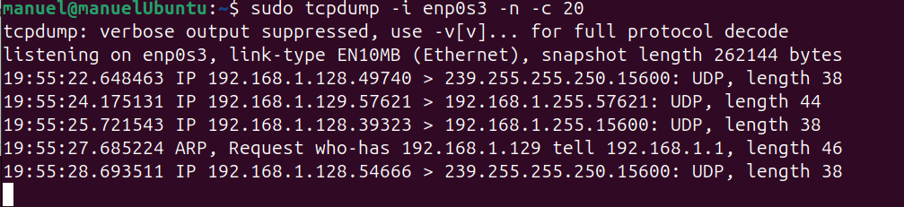

**Interpretación**

Cada línea es un paquete: hora, protocolo, `IP_origen.puerto > IP_destino.puerto`, flags TCP (`[S]` SYN, `[S.]` SYN-ACK, `[.]` ACK, `[P.]` datos, `[F.]` fin, `[R]` reset), números de secuencia y longitud. En ICMP aparece `echo request` / `echo reply`.

Un administrador lo usa para diagnosticar problemas de red: comprobar si las peticiones llegan al servidor, si un firewall está bloqueando respuestas, si el DNS responde o detectar tráfico sospechoso.

---

### tcptrack

**Nombre y finalidad**

`tcptrack` muestra en tiempo real las conexiones TCP activas en una interfaz, con su estado, tiempo inactivo y ancho de banda que consume cada una.

**Sintaxis**

```bash
sudo tcptrack -i interfaz [opciones] [filtro]
```

| Opción | Descripción |
|---|---|
| `-i interfaz` | Interfaz a monitorizar (obligatoria). |
| `-r segundos` | Intervalo para calcular la velocidad media. |
| `-d` | Solo muestra conexiones iniciadas después de arrancar. |
| `filtro` | Filtro estilo tcpdump, p. ej. `port 22`. |

Dentro del programa: `s` ordena (por velocidad o inactividad), `p` pausa, `q` sale.

```bash
sudo tcptrack -i enp0s3
sudo tcptrack -i enp0s3 port 443
```

Para generar conexiones: abrir una conexión SSH o descargar algo con `wget`.

**Captura**

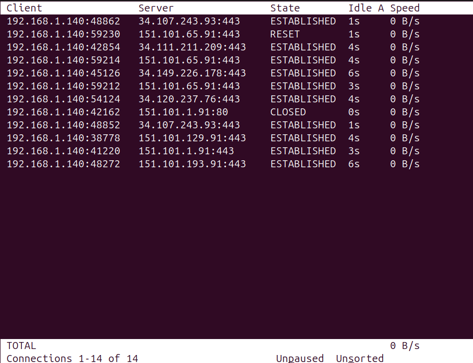

**Interpretación**

- `Client` / `Server`: IP y puerto de cada extremo.
- `State`: estado de la conexión (`SYN_SENT`, `ESTABLISHED`, `CLOSED`, `RESET`).
- `Idle`: tiempo sin actividad.
- `Speed`: velocidad actual de esa conexión.
- Abajo aparece el total de conexiones y el ancho de banda total.

Permite saber qué conexión concreta está consumiendo el ancho de banda del servidor (por ejemplo, un cliente descargando ficheros grandes).

---

### iptraf-ng

**Nombre y finalidad**

`iptraf-ng` (sucesor de `iptraf`) es un monitor de red interactivo con menús. Muestra conexiones IP activas, estadísticas por interfaz, desglose por protocolo y puerto, y estadísticas de la LAN por dirección MAC.

**Sintaxis**

```bash
sudo iptraf-ng [opciones]
```

| Opción | Descripción |
|---|---|
| (sin opciones) | Abre el menú principal. |
| `-i interfaz` | Monitor de tráfico IP en esa interfaz (`all` para todas). |
| `-g` | Estadísticas generales de todas las interfaces. |
| `-d interfaz` | Estadísticas detalladas de una interfaz. |
| `-s interfaz` | Estadísticas por puerto TCP/UDP. |
| `-t minutos` | Sale automáticamente tras ese tiempo. |

```bash
sudo iptraf-ng
sudo iptraf-ng -i all
sudo iptraf-ng -d enp0s3
```

**Captura**

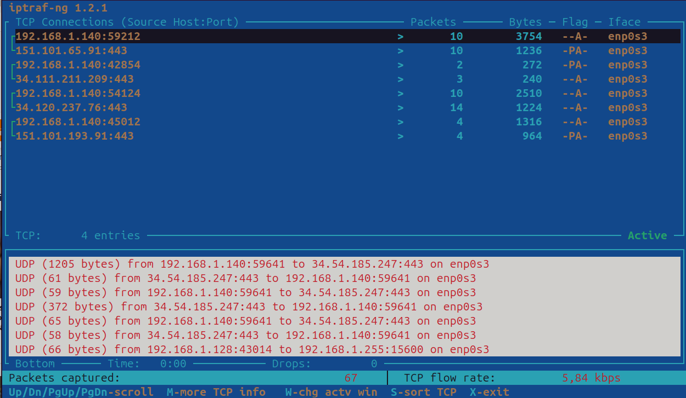

**Interpretación**

En el monitor de tráfico IP, la parte superior lista las conexiones TCP (origen, destino, paquetes, bytes y flags) y la inferior muestra otros paquetes (UDP, ICMP, ARP…). En las estadísticas de interfaz aparecen los paquetes y bytes totales, IP, TCP, UDP, ICMP, errores y la velocidad de entrada y salida.

Es útil para ver de forma clara qué protocolos y puertos generan tráfico y detectar errores en una interfaz.

---

### bmon

**Nombre y finalidad**

`bmon` (*bandwidth monitor*) muestra el ancho de banda de entrada (RX) y salida (TX) de cada interfaz de red en tiempo real, con gráficas en modo texto.

**Sintaxis**

```bash
bmon [opciones]
```

| Opción | Descripción |
|---|---|
| `-p interfaz` | Muestra solo las interfaces indicadas. |
| `-r segundos` | Intervalo de lectura. |
| `-b` | Muestra los valores en bits por segundo. |
| `-o ascii` | Salida en texto simple, sin interfaz interactiva. |

Teclas: flechas para cambiar de interfaz, `d` para ver estadísticas detalladas, `q` salir.

```bash
bmon
bmon -p enp0s3
bmon -p enp0s3 -o ascii
```

**Captura**

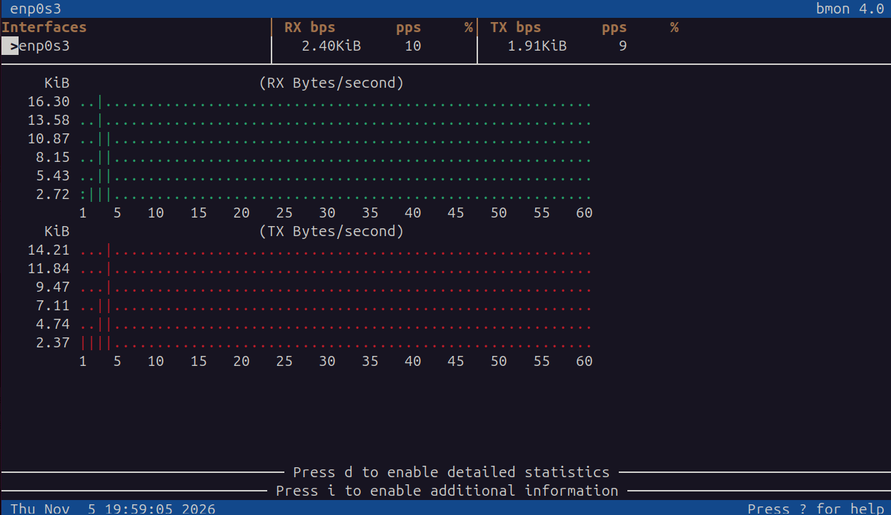

**Interpretación**

En la parte superior aparece cada interfaz con su velocidad actual de recepción (`RX`) y envío (`TX`) en bytes y paquetes por segundo. Debajo, dos gráficas muestran la evolución reciente del tráfico. Con `d` se ven contadores detallados, incluidos errores y paquetes descartados.

Sirve para comprobar rápidamente si una interfaz está saturada o si hay picos de tráfico anormales.

---

## 6. Puertos y conexiones

### ss

**Nombre y finalidad**

`ss` (*socket statistics*) muestra los sockets del sistema: puertos a la escucha y conexiones establecidas, con el proceso que los usa. Es el sustituto moderno de `netstat`.

**Sintaxis**

```bash
ss [opciones] [filtro]
```

| Opción | Descripción |
|---|---|
| `-t` / `-u` | Sockets TCP / UDP. |
| `-l` | Solo sockets a la escucha (*listening*). |
| `-n` | Muestra números de puerto en vez de nombres de servicio. |
| `-p` | Muestra el proceso que usa cada socket (con sudo). |
| `-a` | Todos los sockets (escucha y conexiones). |
| `-s` | Resumen estadístico. |

```bash
sudo ss -tulpn
ss -tn state established
ss -s
sudo ss -tlnp 'sport = :80'
```

**Captura**

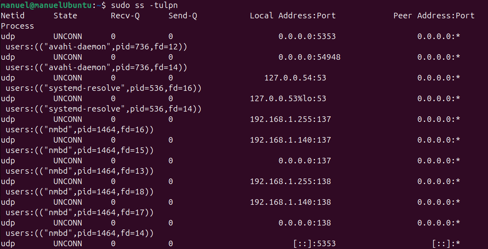

**Interpretación**

- `Netid`: protocolo (tcp, udp).
- `State`: estado (`LISTEN`, `ESTAB`, `TIME-WAIT`…).
- `Recv-Q` / `Send-Q`: datos pendientes en las colas.
- `Local Address:Port`: dirección y puerto local. `0.0.0.0` o `*` significa que escucha en todas las interfaces; `127.0.0.1` solo en local.
- `Peer Address:Port`: el otro extremo de la conexión.
- `Process`: nombre y PID del programa.

Un administrador lo usa para comprobar qué servicios escuchan en el servidor, en qué puertos y si están expuestos a la red o solo en local, y para detectar puertos abiertos que no deberían estarlo.

---

### nmap

**Nombre y finalidad**

`nmap` (*network mapper*) es un escáner de red. Descubre equipos activos en una red y analiza qué puertos tienen abiertos, qué servicios y versiones corren en ellos e incluso el sistema operativo. Se ejecuta desde fuera, como lo vería otro equipo.

> Solo debe usarse sobre equipos y redes propias o con autorización.

**Sintaxis**

```bash
nmap [tipo de escaneo] [opciones] objetivo
```

| Opción | Descripción |
|---|---|
| `-sT` | Escaneo TCP con conexión completa (no requiere root). |
| `-sS` | Escaneo SYN, más rápido y discreto (requiere root). |
| `-sU` | Escaneo de puertos UDP. |
| `-p puertos` | Puertos a escanear (`-p 80`, `-p 1-1000`, `-p-` todos). |
| `-sV` | Detecta el servicio y su versión. |
| `-O` | Intenta detectar el sistema operativo. |
| `-sn` | Solo descubre equipos activos, sin escanear puertos. |

```bash
nmap localhost
sudo nmap -sS -sV 192.168.56.10
nmap -p 80 192.168.56.10
nmap -sn 192.168.56.0/24
```

**Captura**

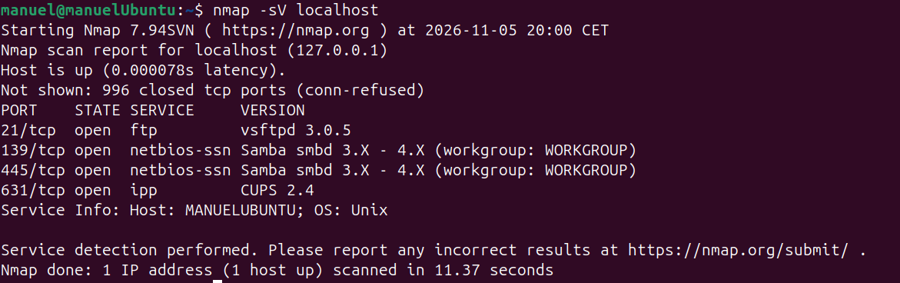

**Interpretación**

- Cabecera: equipo escaneado y si está activo (`Host is up`) con su latencia.
- `PORT`: puerto y protocolo.
- `STATE`: `open` (un servicio acepta conexiones), `closed` (accesible pero sin servicio), `filtered` (un firewall bloquea el paso y no se sabe).
- `SERVICE` / `VERSION`: servicio probable y, con `-sV`, su versión.

Un administrador lo usa para auditar su propia red: comprobar que solo están abiertos los puertos necesarios, verificar que las reglas del firewall funcionan y localizar equipos o servicios desconocidos.

---

## 7. Análisis de resultados

### 1. ¿Cómo comprobarías la cantidad de memoria RAM disponible?

Con `free -h`, fijándome en la columna **`available`** de la fila `Mem`, que indica la memoria que pueden usar los nuevos programas (incluye la caché que el sistema puede liberar). La columna `free` no es buena referencia, porque Linux aprovecha la memoria libre como caché de disco. También se ve en la cabecera de `top`/`htop` o con `cat /proc/meminfo | grep MemAvailable`.

### 2. ¿Qué diferencia existe entre df y du?

- `df` trabaja a nivel de **sistema de ficheros**: dice cuánto espacio total, usado y libre tiene cada partición montada. Responde a "¿cuánto disco me queda?".
- `du` trabaja a nivel de **ficheros y directorios**: suma lo que ocupa una ruta concreta. Responde a "¿qué está ocupando el disco?".

Normalmente se usan juntos: `df` avisa de que una partición está llena y `du` encuentra qué directorio la está llenando. Sus cifras pueden no coincidir, por ejemplo si un proceso mantiene abierto un fichero ya borrado (sigue ocupando espacio para `df` pero `du` no lo ve).

### 3. ¿Qué diferencias existen entre ss y nmap?

| | ss | nmap |
|---|---|---|
| Dónde se ejecuta | En el propio servidor | Desde cualquier equipo de la red |
| Qué muestra | Sockets locales: puertos a la escucha y conexiones, con el proceso | Puertos que se ven abiertos desde fuera, servicios, versiones y SO |
| Firewall | No lo tiene en cuenta: muestra lo que escucha aunque esté bloqueado | Refleja el efecto del firewall (`filtered`) |
| Alcance | Solo el equipo local | Uno o muchos equipos, redes completas |

`ss` dice lo que el servidor **tiene** abierto; `nmap` dice lo que **es accesible** desde la red. Un puerto puede aparecer en `LISTEN` con `ss` y como `filtered` en `nmap` si iptables lo bloquea.

### 4. ¿Cómo comprobarías si un servidor tiene abierto el puerto 80?

- **Desde el propio servidor**, para ver si hay un servicio escuchando:

  ```bash
  sudo ss -tlnp | grep ':80 '
  ```

- **Desde otro equipo**, para ver si es accesible a través de la red y el firewall:

  ```bash
  nmap -p 80 IP_del_servidor
  ```

  Si aparece `80/tcp open http`, el puerto está abierto. También se puede probar con `curl -I http://IP_del_servidor` o `nc -zv IP_del_servidor 80`.

### 5. ¿Qué herramienta utilizarías para detectar un posible cuello de botella en el disco?

**`iostat -x`** (por ejemplo `iostat -xz 2`). Los indicadores de un cuello de botella son un `%util` cercano al 100 %, valores altos de `r_await`/`w_await` (las peticiones tardan en atenderse), una cola `aqu-sz` grande y un `%iowait` de CPU elevado. Como complemento, `top` muestra el `wa` de la CPU y procesos en estado `D`, y `atop` permite ver qué proceso concreto genera la carga de disco (y revisarlo en el histórico).

### 6. ¿Por qué es importante monitorizar los recursos de un servidor?

- **Detectar problemas antes de que provoquen una caída**: un disco que se llena, memoria que se agota o una CPU saturada pueden dejar sin servicio a los usuarios.
- **Diagnosticar fallos y lentitud**: saber si un problema se debe a CPU, memoria, disco o red, y qué proceso lo causa.
- **Seguridad**: detectar puertos abiertos innecesarios, conexiones o tráfico sospechoso y procesos desconocidos.
- **Planificación de capacidad**: conocer el consumo habitual para saber cuándo ampliar hardware o recursos de la máquina virtual.
- **Disponibilidad y cumplimiento de servicio**: mantener los servicios funcionando y tener datos para justificar decisiones o investigar incidencias pasadas.
